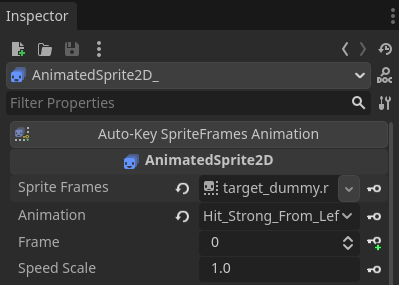
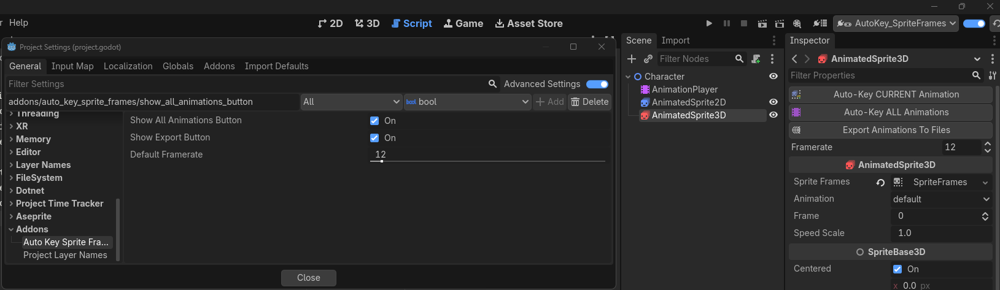

##  Auto-Keyframe `AnimatedSprite2D` / `AnimatedSprite3D`'s `SpriteFrames` 

#### *A QOL Plugin for Godot 4.2+*

This Godot editor plugin is designed to streamline the process of animating an `AnimatedSprite2D` or `AnimatedSprite3D` node with an `AnimationPlayer`. It reduces the tedious manual work of keyframing each frame of a sprite animation down to a single button-press.


## How to Use

### Installation

1. Place the `AutoKey_SpriteFrames` folder inside your project's `addons` directory.
2. Enable the plugin in `Project > Project Settings > Plugins`.

The final file structure should look like this:
```
res://addons/AutoKey_SpriteFrames/
├── AutoKey_SpriteFrames.gd
├── inspector_plugin.gd
├── plugin.cfg
├── license.md
└── README.md
```

### Usage



1.  Select an `AnimatedSprite2D` or `AnimatedSprite3D` node in the scene tree. 
	- The Inspector shows **Auto-Key CURRENT Animation**, optionally **Auto-Key ALL Animations** and **Export Animations To Files**, plus a **Framerate** field.
2.  Ensure it has a sibling `AnimationPlayer` node.
3.  Assign a `SpriteFrames` resource to your animated sprite.
4.  Select the animation you want to auto-key in the `Animation` property below `Sprite Frames`.
5.  Set the desired **Framerate**.
6.  Click the button.

### Settings



Plugin settings live in **Project Settings > Addons > auto_key_sprite_frames**:

| Setting | Default | Description |
| --- | --- | --- |
| `show_all_animations_button` | `true` | Shows the **Auto-Key ALL Animations** button. |
| `show_export_button` | `true` | Shows the **Export Animations To Files** button. |
| `default_framerate` | `16` | Starting value for the Inspector's **Framerate** field. |

The Inspector's **Framerate** field controls the FPS used for the generated keyframes. It is an override for the next operation and is not written back to the plugin settings.


## What It Does

When the button is clicked, the plugin will:

1.   Find the sibling `AnimationPlayer`.
2.   Get the current animation name from the animated sprite (e.g., "walk").
3.   Create a new `Animation` resource in the `AnimationPlayer` with that name, or find an existing one.
4.   **Automatically generate two tracks:**
		i.   `<SpriteNode>:animation`: Sets the current animation name at time `0.0`.
		ii.   `<SpriteNode>:frame`: Creates a keyframe for every single frame of the animation in the `SpriteFrames` resource. The timing of these keyframes is based on the Inspector's **Framerate** field.
		*   **WARNING**: This will clear all existing frames of the above-mentioned tracks.
5.   Set the animation's step (timeline FPS) to the selected framerate, and set the total length to match the sprite animation's duration.

This allows you to instantly create a perfectly timed `AnimationPlayer` animation from your `SpriteFrames` with a single click.


## About

By Kaiiboraka. Made in Godot 4.2, updated in 4.5 and in 4.8. Other Godot versions not thoroughly tested.  
Re-uploaded and updated from my original plugin on the old Godot Asset Library: [https://godotengine.org/asset-library/asset/4186](https://godotengine.org/asset-library/asset/4186)

### Why

I was getting really fed up with the tedium of finding the **AnimatedSprite**, clicking on the **Animation** window, creating a new animation, key the "animation" property on the **SpriteFrames**, click yes to the dialog, and then keying every single frame (however long it is) by carpal-tunneling myself to tears going back and forth between clicking the little up-arrow on the frame, and the key next to it, over and over and over.

This does all of those things in ONE button press.

All you need to do is go to the **AnimatedSprite**, assign a **SpriteFrames**, select an animation, and click the button for each or every animation. EZ-PZ.

### License

Licensed under CC0. See `license.md`. I don't care what you do with it, go nuts. Credit me if you like.
